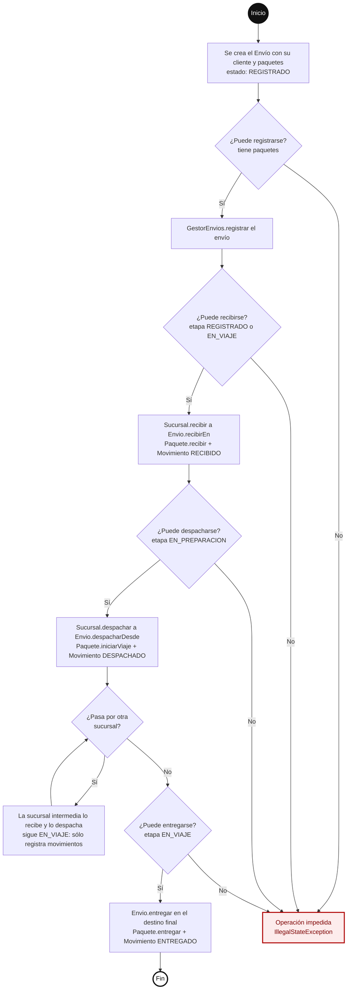

# Diagrama de Actividad — TP2

> Flujo completo del **ciclo de vida de un envío**: desde su creación hasta la
> entrega, con cada regla de negocio como decisión.

## Definición

El **diagrama de actividad** es un diagrama de UML que representa el **flujo de
trabajo** (workflow) de un proceso: qué acciones se realizan, en qué orden, qué
decisiones se toman, qué partes se repiten y dónde termina el proceso.

Se enfoca en **qué se hace** para lograr una operación:

- no dice **qué objetos** participan ni en qué orden reciben los mensajes
  (eso lo muestra el **diagrama de secuencia**);
- ni describe **de qué está compuesto** el sistema (eso es el **diagrama de
  clases**);
- y no entra en el detalle interno del código (eso es el código fuente).

Se usa cuando interesa seguir un proceso **de principio a fin**, con
alternativas y ciclos, de manera legible para cualquier interesado.

## Notación

| Símbolo | Significado | Uso en este trabajo |
|---------|-------------|---------------------|
| `((Inicio))` | **Nodo inicial**: comienza la actividad | Se crea el envío con su cliente |
| Rectángulo `[…]` | **Acción / actividad**: algo que se hace | registrar, recibir, despachar, entregar |
| Rombo `{…}` | **Decisión**: pregunta con ramas alternativas | ¿Tiene paquetes?, ¿puede recibirse?… |
| Flecha `-->` | **Flujo de control**: indica el orden | De una acción a la siguiente o a una decisión |
| Flecha que vuelve atrás | **Ciclo / iteración**: la acción se repite | ¿Pasa por otra sucursal? → sí → se repite |
| `((Fin))` | **Nodo final**: termina el proceso | Envío entregado / operación impedida |

Cada acción del diagrama corresponde a **una operación real del modelo** (una
llamada entre objetos: `Sucursal → Envio → Paquete`), y cada rombo corresponde
a una **validación** del TP2.1: si la respuesta es "no", la operación termina
en una excepción `IllegalStateException`.

## Diagrama

## Correspondencia con el código

| Actividad del diagrama | Operación en el código |
|------------------------|------------------------|
| Se crea el envío | `new EnvioEstandar(cliente, destino, paquetes...)` |
| ¿Puede registrarse? | `GestorEnvios.registrar()` — rechaza envíos sin paquetes |
| ¿Puede recibirse? | `Envio.recibirEn()` — sólo REGISTRADO o EN_VIAJE (tránsito) |
| Recibir | `Sucursal.recibir()` → `Envio.recibirEn()` → `Paquete.recibir()` |
| ¿Puede despacharse? | `Envio.despacharDesde()` — sólo EN_PREPARACION o EN_VIAJE |
| Despachar | `Sucursal.despachar()` → `Envio.despacharDesde()` → `Paquete.iniciarViaje()` |
| Ciclo de sucursales | sucursales intermedias: mismo flujo, el estado sigue EN_VIAJE |
| ¿Puede entregarse? | `Envio.entregar()` — exige etapa EN_VIAJE |
| Entregar | `Envio.entregar()` → `Paquete.entregar()` + `Movimiento(ENTREGADO)` |
| Operación impedida | excepción `IllegalStateException` / `NoSuchElementException` |
