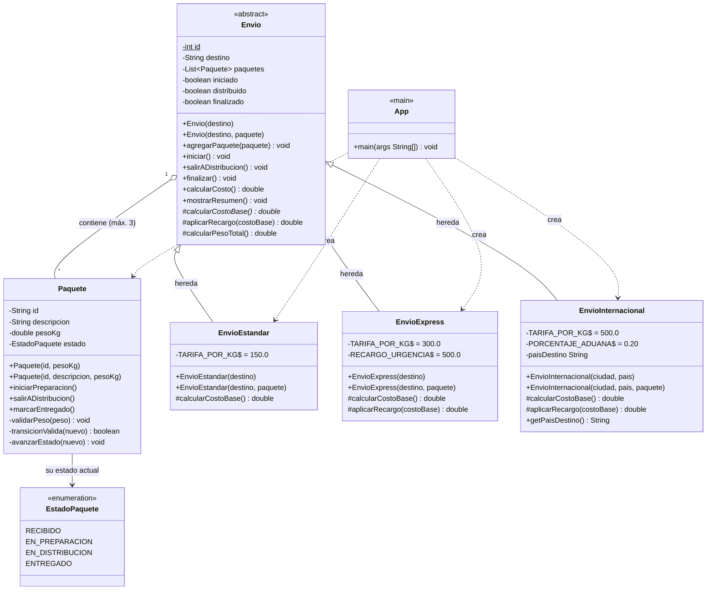

# Diagrama de Clases — Sistema de Gestión de Envíos

> Los *getters* simples se omiten en el diagrama para mantenerlo legible;
> todos existen en el código fuente.



## Leyenda

| Símbolo | Significado |
|---------|-------------|
| `-` | Atributo / método `private` |
| `+` | Método `public` |
| `#` | Método `protected` |
| `*` al final | Método **abstracto** (debe implementarse en las subclases) |
| `$` | Miembro `static` (compartido por todas las instancias) |
| `<<enumeration>>` | Enum de valores fijos |
| `<<abstract>>` | Clase que no se puede instanciar directamente |
| `<\|--` | Herencia (una subclase **es un** tipo de la superclase) |
| `o--` | Asociación (un envío **contiene** paquetes) |
| `..\>` | Dependencia (una clase **crea o usa** a otra) |

## Ciclo de vida del paquete

```
RECIBIDO ──iniciarPreparacion()──▶ EN_PREPARACION ──salirADistribucion()──▶ EN_DISTRIBUCION ──marcarEntregado()──▶ ENTREGADO
```

Cada etapa solo avanza **de a un paso**; saltarse una genera `IllegalStateException`.
En `Envio` cada etapa tiene su propio método: `iniciar()` · `salirADistribucion()` · `finalizar()`.
