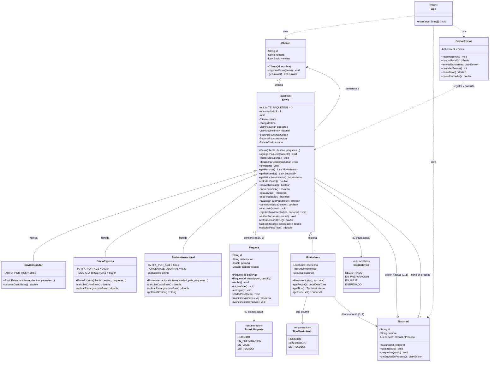

# Diagrama de Clases — Sistema de Gestión de Envíos (TP2)

> Los *getters* simples se omiten en el diagrama para mantenerlo legible;
> todos existen en el código fuente.



## Leyenda

| Símbolo | Significado |
|---------|-------------|
| `-` | Atributo / método `private` |
| `+` | Método `public` |
| `#` | Método `protected` |
| `~` | Método **package-private** (visible solo dentro del sistema) |
| `*` al final | Método **abstracto** (debe implementarse en las subclases) |
| `$` | Miembro `static` (compartido por todas las instancias) |
| `<<enumeration>>` | Enum de valores fijos |
| `<<abstract>>` | Clase que no se puede instanciar directamente |
| `<\|--` | Herencia (una subclase **es un** tipo de la superclase) |
| `o--` | Asociación (contención) |
| `..\>` | Dependencia (una clase **crea o usa** a otra) |

## Ciclo de vida del paquete

```
RECIBIDO ──recibir()──▶ EN_PREPARACION ──iniciarViaje()──▶ EN_VIAJE ──entregar()──▶ ENTREGADO
```

Cada etapa solo avanza **de a un paso**; saltarse una genera `IllegalStateException`.
Esos tres métodos son **package-private**: los invoca únicamente su `Envio`
(los paquetes no cambian de estado porque App se lo pida).

## Ciclo de vida del envío

```
REGISTRADO ──recibirEn()──▶ EN_PREPARACION ──despacharDesde()──▶ EN_VIAJE ──entregar()──▶ ENTREGADO
```

- `Sucursal.recibir(envio)` → `Envio.recibirEn(sucursal)` → `Paquete.recibir()`
- `Sucursal.despachar(envio)` → `Envio.despacharDesde(sucursal)` → `Paquete.iniciarViaje()`
- `Envio.entregar()` (el destino final no siempre es una sucursal)
- Una sucursal intermedia **recibe/despacha un envío EN_VIAJE sin cambiar su
  etapa**: sólo registra el paso en el historial (la máquina de estados no
  retrocede).

## Historial de movimientos

`Envio` es el dueño de su `List<Movimiento>`: él crea los registros
(constructor `Movimiento` package-private, campos `final`) y responde las
consultas **devolviendo datos** (TP2.1): `getHistorial()`, `getRecorrido()`,
`getUltimoMovimiento()`. Quien los muestre (App) sólo presenta lo recibido.

## Reglas del negocio con nombre propio (TP2.1)

Las comprobaciones reutilizables viven como métodos **privados** del objeto que
las usa — por ejemplo en `Envio`: `todaviaNoSalio()`, `enPreparacion()`,
`estaEnViaje()`, `estaFinalizado()`, `hayLugarParaPaquetes()`. El avance de
estados no usa cadenas de `if/else` ni `switch`: lo resuelven
`transicionValida(nuevo)` + `avanzarA(nuevo)`, igual que en `Paquete`.
