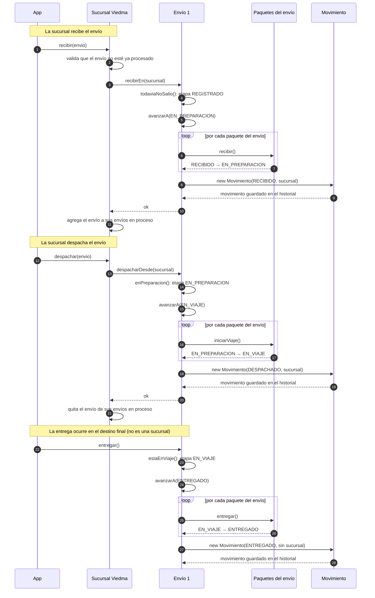
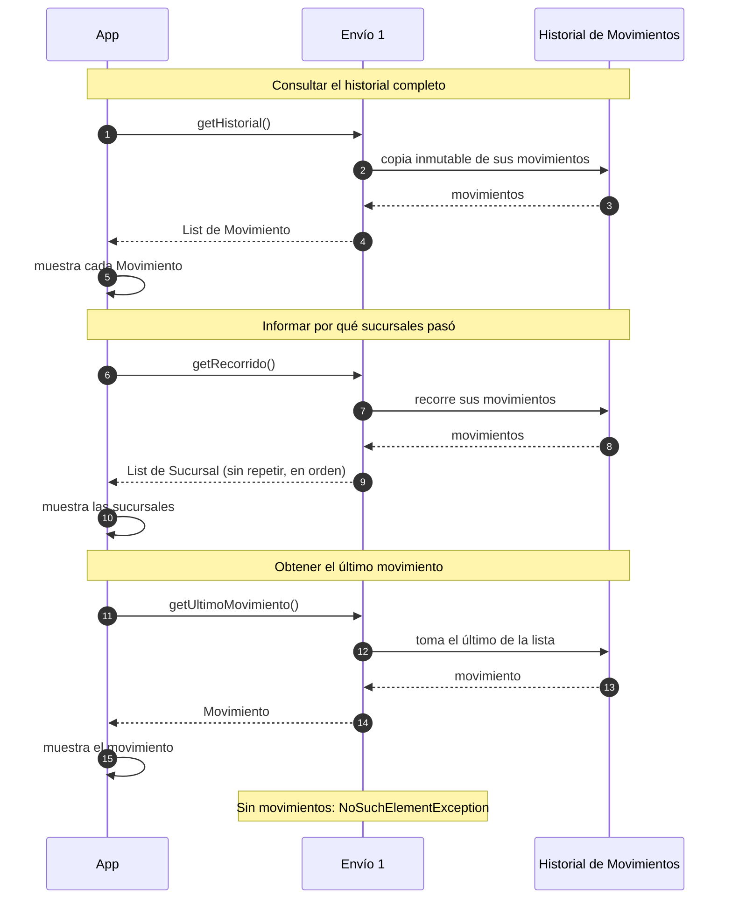

# Diagramas de Secuencia — TP2.1

> Dos funciones principales del sistema, según el enunciado 2.1: muestran el
> objeto que inicia la operación, los objetos que participan, los mensajes que
> se envían y el orden en que ocurren.

## 1. Recorrido de un envío (recibir → despachar → entregar)

La colaboración central del modelo: **App → Sucursal → Envio → Paquete**, con
el registro de `Movimiento` a cargo del envío.

## 2. Consulta del seguimiento de un envío

Las consultas **devuelven datos** (TP2.1); quien los muestra es App.

